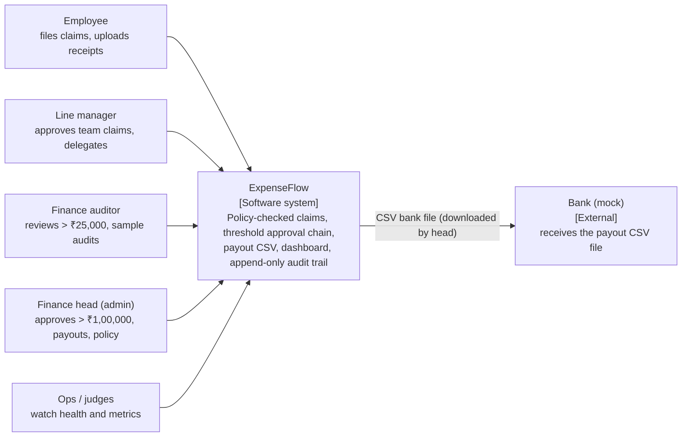
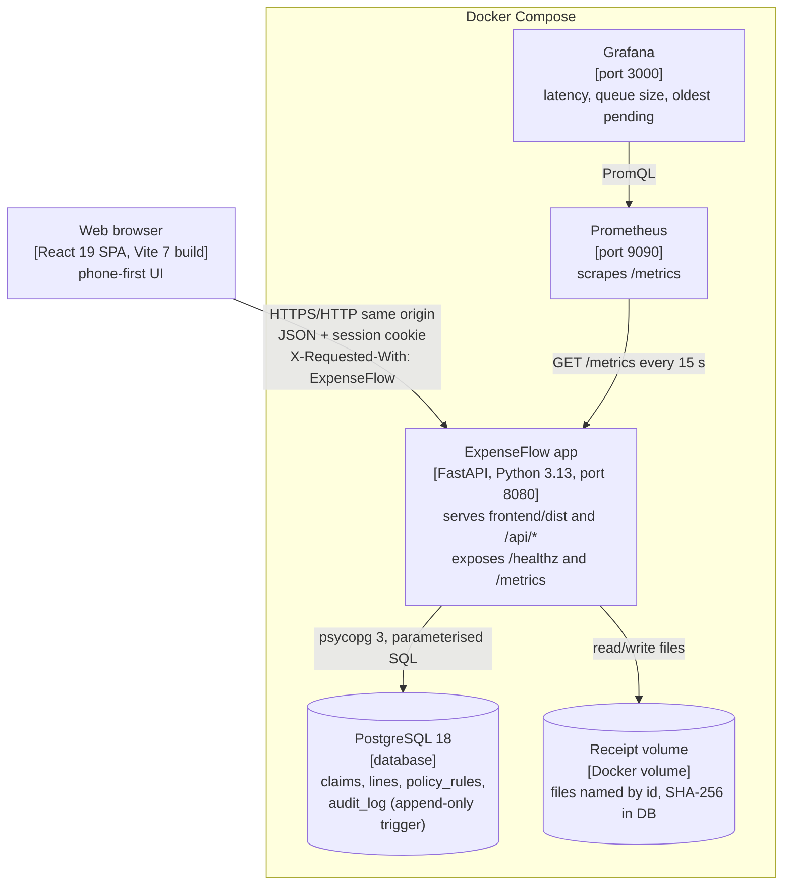
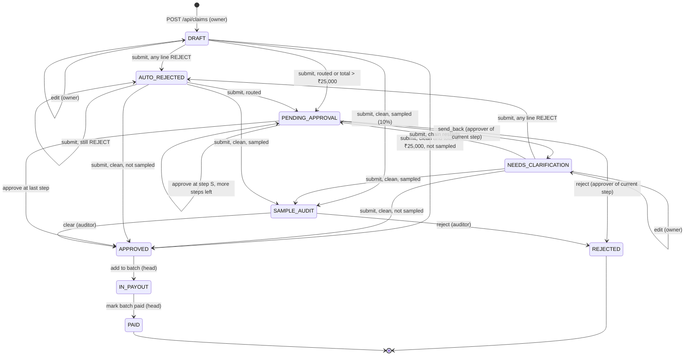
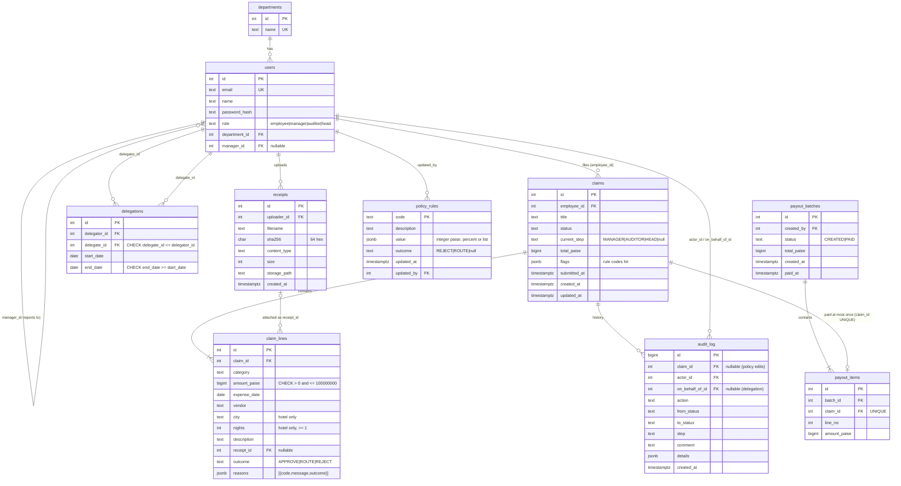
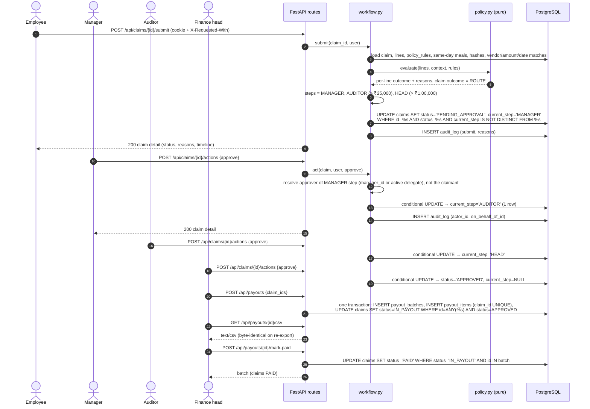

# ExpenseFlow — Low-Level Design

**Team 01 · AI Manthan Day 2 · Track A**
Sources of truth: `CLAUDE.md` (state machine, API, schema, metrics) and `submission/ideation.md` (decisions D1–D15). If this document and those files disagree, those files win and this document gets fixed.

Related: [ADR-01 Approval chain](adr-01-approval-chain.md) · [ADR-02 Policy as configuration](adr-02-policy-as-config.md) · [API contract](api-contract.md) · [Test plan](test-plan.md)

---

## 1. System context (C4 level 1)



## 2. Containers (C4 level 2)



One origin (port 8080) means no CORS configuration and a `SameSite=Lax` cookie works without exceptions.

## 3. Claim state machine

Exactly the table in `CLAUDE.md`. Any transition not drawn here returns **HTTP 409**.



`current_step` is `MANAGER`, `AUDITOR` or `HEAD` while the claim is `PENDING_APPROVAL`, and `NULL` in every other state.

## 4. Data model

`backend/app/schema.sql` is authoritative. The ER diagram shows the tables named in CLAUDE.md and the columns this design relies on.



Money is `bigint` paise everywhere; timestamps are `timestamptz` (UTC) and shown in IST; expense dates are plain `date`.

## 5. Sequence: submit → policy → approval chain → payout

Example: a ₹1,20,000 claim with one weekend line (routed). Steps: MANAGER → AUDITOR → HEAD.



## 6. Module breakdown (`backend/app`)

| Module | Responsibility | Depends on |
|---|---|---|
| `main.py` | Builds the FastAPI app; mounts routers under `/api`; CSRF middleware; metrics middleware; serves `frontend/dist` with SPA fallback; `/healthz`; error handler that renders `{"detail","code"}` | all routers, `db`, `metrics` |
| `db.py` | psycopg 3 connection pool from `DATABASE_URL`; `transaction()` context manager; helpers returning dict rows. **Parameterised SQL only** | — |
| `auth.py` | Password check (hashed demo password `demo123`), signed HttpOnly session cookie, `current_user` dependency, `require_role(...)` dependency, `/api/auth/*` and `/api/demo-users` | `db` |
| `policy.py` | **Pure** evaluator: `evaluate(lines, context, rules) -> PolicyResult`. No DB, no clock (today is passed in), no randomness. Also `is_sampled(claim_id, salt, percent)` and line validation | — |
| `workflow.py` | State machine: `TRANSITIONS` table, `submit`, `act` (approve / reject / send_back / clear), step planning from thresholds, approver resolution, delegation lookup, `allowed_actions(claim, user)`, conditional UPDATE + audit insert in one transaction | `db`, `policy` |
| `routes/` | Thin HTTP layer: claims, receipts, approvals (inbox, bulk), audit queue, delegations, users, policy, audit-log. Visibility check (404) before permission check (403) | `workflow`, `auth`, `db` |
| `payouts.py` | Eligible list, batch creation, deterministic CSV writer, mark-paid | `db`, `workflow` |
| `dashboard.py` | Aggregate SQL for KPIs, spend by category / department / month, violations by rule, avg approval hours | `db` |
| `metrics.py` | Prometheus registry: request histogram, queue-size and oldest-pending gauges (refreshed on scrape), transition and policy-outcome counters | `db` |
| `seed.py` | Idempotent synthetic seed: 8 departments, 150 users with a hierarchy, policy defaults, 3,000 historical claims with planted duplicates and limit breaches. Fixed random seed | `db`, `policy` |
| `schema.sql` | Tables, CHECK constraints, `UNIQUE(payout_items.claim_id)`, append-only trigger on `audit_log` | — |

Rule of thumb: **routes never change `claims.status` directly**; only `workflow.py` and `payouts.py` do, and only through the conditional UPDATE.

## 7. Policy as configuration

Decision record: [ADR-02](adr-02-policy-as-config.md).

- Rules live in `policy_rules(code, description, value, outcome)`. Seed defaults are in CLAUDE.md. The engine has **no limit numbers in code**; a test asserts that changing `MEAL_DAILY_LIMIT` in the table changes the outcome.
- On submit, `workflow.py` loads all rules into a `dict[code → value]` and gathers the context the pure function needs:
  - `meal_spent_same_day[date]`: sum of the employee's meal lines on that date in **other non-rejected claims** (D5).
  - `known_receipt_hashes`: SHA-256 values on lines of other non-rejected claims.
  - `prior_vendor_amount_date`: normalised `(lower(trim(vendor)), amount_paise, expense_date)` on earlier non-rejected lines.
  - `today` (IST date) for date validation.
- `policy.evaluate` returns, for each line, a list of `{code, message, outcome}` and the line outcome = worst of them (REJECT > ROUTE > APPROVE). The claim outcome = worst line outcome; if APPROVE but `total > AUTO_APPROVE_MAX_TOTAL`, it becomes ROUTE (D3).

| Rule | Check (strictly greater than, in paise) | Outcome |
|---|---|---|
| MEAL_DAILY_LIMIT | this day's meals across all non-rejected claims > 150000 | ROUTE |
| HOTEL_NIGHT_LIMIT_TIER1 | city ∈ TIER1_CITIES and amount > 600000 × nights | ROUTE |
| HOTEL_NIGHT_LIMIT_OTHER | other city and amount > 400000 × nights | ROUTE |
| CAB_TRIP_LIMIT | `local_cab` line amount > 200000 | ROUTE |
| RECEIPT_REQUIRED_ABOVE | amount > 50000 and `receipt_id` is null | REJECT |
| DUPLICATE_RECEIPT_HASH | receipt SHA-256 already on another non-rejected line | REJECT |
| DUPLICATE_VENDOR_AMOUNT_DATE | same normalised vendor + amount + date as an earlier non-rejected line | ROUTE |
| WEEKEND_SPEND | expense_date is Saturday or Sunday | ROUTE |
| AUTO_APPROVE_MAX_TOTAL | clean claim total > 2500000 | ROUTE |

Sample audit (D11): an auto-approved claim goes to `SAMPLE_AUDIT` when `int(sha256(f"{claim_id}:{SAMPLE_SALT}"), 16) % 100 < SAMPLE_AUDIT_PERCENT`. Deterministic, so it is testable and cannot be re-rolled by resubmitting.

City matching for tier-1 is case-insensitive and trimmed. Policy edits (`PUT /api/policy/{code}`, head only) write an audit entry with old and new values and only affect claims submitted afterwards.

## 8. Approval chain: step planning, approver resolution, delegation

Decision record: [ADR-01](adr-01-approval-chain.md). The claim stores only `status` and `current_step`; who may act is **computed** each time.

**Step planning at submit** (claim outcome is ROUTE):
1. `MANAGER` — included unless the claimant's `manager_id` is null or equals the claimant; then it is skipped and `AUDITOR` becomes mandatory regardless of total.
2. `AUDITOR` — if `total_paise > AUDITOR_THRESHOLD` (2,500,000), or mandatory per step 1.
3. `HEAD` — if `total_paise > HEAD_THRESHOLD` (10,000,000). Skipped if the claimant is the only head; the audit log records `head_step_skipped_self`.

`current_step` = first planned step. On approve, the next planned step is recomputed from the same rules (thresholds read from config at that moment, total cannot change because editing is blocked), or `APPROVED` if none remain. Send-back clears the step; resubmit re-plans from scratch (D8).

**Can user U act on claim C at step S?**

```
can_act(U, C) =
    C.status == PENDING_APPROVAL
    and U.id != C.employee_id                       # nobody approves own claim
    and ( U is the approver of S
          or exists delegation d: d.delegate_id = U.id
                                  and d.start_date <= today_ist <= d.end_date
                                  and d.delegator_id is the approver of S
                                  and d.delegator_id != C.employee_id )
approver of MANAGER = claimant.manager_id
approver of AUDITOR = any user with role auditor
approver of HEAD    = any user with role head
```

For `SAMPLE_AUDIT`, `clear`/`reject` requires role `auditor` and not the claimant.

**Delegation rules (D9):** created by a manager, auditor or head; `delegate_id != delegator_id` (422 and DB CHECK); `end_date >= start_date`. The delegate cannot act on their own claim (covered by the `U.id != C.employee_id` check). Each action records `actor_id = U` and `on_behalf_of_id = delegator` so the timeline reads "approved by X on behalf of Y". Delegations are not transitive (a delegate cannot re-delegate the authority they received).

`allowed_actions` in the claim detail is produced by the same `can_act` function, so the UI never offers a button the server would refuse.

## 9. Concurrency control

Every transition is one conditional UPDATE inside a transaction, followed by an audit insert in the same transaction:

```sql
UPDATE claims
   SET status = %(to_status)s, current_step = %(to_step)s, updated_at = now()
 WHERE id = %(id)s
   AND status = %(from_status)s
   AND current_step IS NOT DISTINCT FROM %(from_step)s
RETURNING id;
```

- 0 rows → `409 CONCURRENT_UPDATE` ("someone else acted first"); the transaction rolls back, so no orphan audit row.
- Two managers (manager + delegate) clicking approve at the same instant: exactly one succeeds. Same for a double-clicked approve and for bulk approve racing a single approve.
- `IS NOT DISTINCT FROM` makes the guard work when `current_step` is NULL.
- Edits (`PUT /api/claims/{id}`) use the same guard on the editable status, so an edit cannot land after the claim was submitted in another tab.
- Submit-time aggregation (meal per day): two simultaneous submits by the same employee could each see the other's meals as absent. Design: `submit` takes `pg_advisory_xact_lock(employee_id)` to serialise one employee's submits. Cheap, and it does not block other employees.

## 10. Duplicate-payment prevention (D12)

Defence in depth, from cheapest to strongest:
1. **At submit:** `DUPLICATE_RECEIPT_HASH` auto-rejects a reused receipt file; `DUPLICATE_VENDOR_AMOUNT_DATE` routes a probable re-claim to a human.
2. **Eligibility:** only `APPROVED` claims are payable. `SAMPLE_AUDIT` claims are held until an auditor clears them.
3. **State guard:** batch creation moves claims `APPROVED → IN_PAYOUT` with `WHERE status='APPROVED'`; if the count differs from the requested ids the whole batch rolls back (409).
4. **Database:** `payout_items.claim_id UNIQUE`. Even a bug in steps 2–3 cannot put a claim in two batches.
5. **Mark paid once:** `IN_PAYOUT → PAID` is conditional; a second mark-paid returns 409.
6. **Deterministic CSV:** re-export reads the stored items in `line_no` order and produces a byte-identical file, so a re-download is visibly the same file, not a new payment instruction.

## 11. Security design

| Concern | Design |
|---|---|
| Authentication | Email + password against a hashed demo password. On success the server sets a **signed, HttpOnly, SameSite=Lax** session cookie (`Secure` when served over HTTPS). Signing key from `SESSION_SECRET` env var, never logged or committed. Logout clears the cookie. |
| CSRF | Every non-GET `/api` request must carry `X-Requested-With: ExpenseFlow`, else 403 `CSRF_HEADER_MISSING`. A cross-site form cannot set custom headers, and SameSite=Lax blocks cross-site cookie sends on POST. |
| Authorisation | Order of checks on every claim endpoint: (1) authenticated → else 401; (2) **visible** (owner, current approver or active delegate, auditor, head) → else **404**, so ids of other people's claims are not confirmed; (3) role / current-approver / not-own-claim → else 403; (4) transition allowed from current state → else 409. |
| Ownership | List endpoints filter in SQL (`WHERE employee_id = %s`) for the employee view; receipts are served only to the uploader or someone who can see a claim using the receipt. |
| Audit trail | `audit_log` has a trigger `BEFORE UPDATE OR DELETE ... RAISE EXCEPTION`. The app never issues UPDATE/DELETE on it. Every transition, policy edit, delegation change, payout and `head_step_skipped_self` is logged with actor and on-behalf-of. |
| Uploads | Max 5 MB (checked while streaming); allowed types jpg/png/pdf checked by **magic bytes**, not only by extension or client content type; stored under a server-generated name in a volume outside the web root; SHA-256 computed server-side; served with `Content-Disposition` and `X-Content-Type-Options: nosniff`. |
| Injection | psycopg 3 parameterised queries only; filters in `/api/audit/queue` map to fixed SQL fragments, never string-built column names. |
| Input validation | Pydantic models + line validation (amount 1..100000000 paise, date not future and ≤ 365 days old, hotel city + nights ≥ 1, vendor required, category in the fixed list). |
| Secrets & data | No real data; synthetic seed. No secrets in logs; request logs omit cookies and bodies. |
| Supply chain | CI runs `pip-audit` and `npm audit`. |

## 12. Ways to bypass approvals and how we block each

Reviewed as a sceptical finance auditor would: "Show me the control and show me the test that proves it." Test paths are the agreed targets in `backend/tests/` and `frontend/e2e/`.

| # | Bypass attempt | Control that blocks it | Proof (automated test) |
|---|---|---|---|
| 1 | **Self-approval**: a manager or auditor approves their own claim via the API | `can_act` rejects `user.id == claim.employee_id` → 403 `SELF_APPROVAL`; own claims never appear in own inbox | `test_workflow.py::test_owner_cannot_approve_own_claim` |
| 2 | **Self-approval via delegation**: X delegates to Y, Y files a claim and approves it as X's delegate | Same `can_act` check runs for delegates; delegate's own claim → 403 | `test_delegation.py::test_delegate_cannot_act_on_own_claim` |
| 3 | **Delegating to self** to look like a second pair of eyes | API 422 `DELEGATE_SELF` + DB CHECK `delegate_id <> delegator_id` | `test_delegation.py::test_cannot_delegate_to_self` |
| 4 | **Manager with no manager** (or own `manager_id` = self) gets the manager step skipped | Skipped MANAGER step makes AUDITOR mandatory, regardless of total | `test_workflow.py::test_missing_manager_makes_auditor_mandatory` |
| 5 | **Only head files a ₹2 lakh claim** and no other head exists | HEAD step skipped, but AUDITOR still required (> ₹25,000) and audit log records `head_step_skipped_self` | `test_workflow.py::test_sole_head_claim_skips_head_logs_event` |
| 6 | **Acting out of turn**: auditor or head approves while the claim is at MANAGER | Only the approver of `current_step` (or their delegate) may act → 403 `NOT_CURRENT_APPROVER` | `test_workflow.py::test_auditor_cannot_act_at_manager_step` |
| 7 | **Replaying an approve** (double click, browser retry, scripted replay) to skip the next step | Conditional UPDATE on `(status, current_step)`; replay sees a different step → 409 `CONCURRENT_UPDATE` / 403 | `test_concurrency.py::test_double_approve_only_one_wins`, `test_workflow.py::test_replayed_approve_does_not_skip_step` |
| 8 | **Edit after approval**: change amounts once the manager has approved | PUT allowed only in DRAFT / NEEDS_CLARIFICATION / AUTO_REJECTED → 409; send-back + resubmit restarts the chain from MANAGER and re-runs policy | `test_api_claims.py::test_edit_after_submit_is_409`, `test_workflow.py::test_resubmit_restarts_chain_from_manager` |
| 9 | **Splitting one large claim** into several ≤ ₹25,000 claims to avoid auditor/head | Thresholds use claim total; per-day meal limit and vendor+amount+date duplicate rule aggregate **across** claims; 10% sample audit of auto-approved; dashboard shows per-employee spend. **Residual risk** (honest): genuinely distinct small clean claims can still auto-approve; rolling per-employee monthly cap is backlog | `test_policy.py::test_meal_limit_sums_across_claims`, `test_policy.py::test_vendor_amount_date_duplicate_routes` |
| 10 | **Bumping one meal across claims** (₹1,000 + ₹1,000 same day in two claims) | MEAL_DAILY_LIMIT sums the employee's non-rejected claims for that date → ROUTE | `test_policy.py::test_meal_limit_sums_across_claims` |
| 11 | **Reusing a receipt** on a second claim | DUPLICATE_RECEIPT_HASH (SHA-256 of file bytes) → auto-reject | `test_policy.py::test_duplicate_receipt_hash_rejects` |
| 12 | **Big clean claim auto-approved** (no flags, ₹2 lakh) | AUTO_APPROVE_MAX_TOTAL: clean claims > ₹25,000 are routed (D3) | `test_policy.py::test_clean_claim_above_25000_routes` |
| 13 | **Direct API calls** skipping the UI (no buttons needed) | All checks are server-side; `allowed_actions` is advisory only; tests call the API with no UI | `test_api_security.py::test_employee_cannot_call_action_endpoint` |
| 14 | **Seeing / approving another team's claim** by guessing ids | Visibility check → 404; manager sees only claims where they are current approver or delegate | `test_api_security.py::test_employee_cannot_see_other_claim_404` |
| 15 | **Editing or deleting the audit log** to hide an action | DB trigger raises on UPDATE/DELETE of `audit_log` | `test_audit_log.py::test_audit_log_update_and_delete_raise` |
| 16 | **Paying a claim twice** (two batches, or double mark-paid) | Only APPROVED eligible; `payout_items.claim_id UNIQUE`; conditional IN_PAYOUT→PAID | `test_payouts.py::test_claim_cannot_be_in_two_batches`, `test_payouts.py::test_mark_paid_twice_is_409` |
| 17 | **Paying a sampled claim before audit** | SAMPLE_AUDIT is not APPROVED, so not eligible for payout | `test_payouts.py::test_sample_audit_claim_not_eligible` |
| 18 | **Bulk approve sneaking in claims at the wrong step** | Bulk runs `can_act` per claim; failures come back per item with an error, others unaffected | `test_approvals.py::test_bulk_approve_reports_per_item_errors` |
| 19 | **Cross-site request** making a logged-in head approve | CSRF header required on non-GET + SameSite=Lax cookie → 403 | `test_api_security.py::test_post_without_csrf_header_is_403` |
| 20 | **Raising a limit** just before submitting your own claim | Policy edit is head-only and audited with old/new value; visible in audit log and timeline | `test_api_policy.py::test_policy_update_requires_head_and_is_audited` |

## 13. Observability

`/metrics` exposes the five metrics in CLAUDE.md. The gauges `expenseflow_approval_queue_size{step}` and `expenseflow_oldest_pending_approval_hours` are computed with one SQL query at scrape time, so they are always correct after restarts. Route labels use the route template (`/api/claims/{id}`), not the raw path, to keep label cardinality bounded. Grafana dashboard: p95 latency by route, queue size by step, oldest pending hours, transitions per status, policy outcomes.
